<div align="center">



<br/>


</div>

---

## 🩺 Project Overview

A **web-based Healthcare Claims Tracking and Denial Management System** that provides a centralized platform for managing claims, tracking statuses, recording denial reasons, assigning follow-up tasks, and generating analytical reports.

Built as an academic prototype for **Advanced Database Management Systems (CS304.3)**, with a strong focus on **data integrity, transaction management, query optimization, and database-level business logic**.

> 🏢 **Organization Context:** Innobot Health (Pvt) Ltd.

---

## 🎯 Project Objectives

| | Objective |
|:-:|:---|
| 📁 | Manage healthcare claim records |
| 🔄 | Track claim statuses and payment information |
| ❌ | Record denial reasons and resolution progress |
| ✅ | Assign and monitor follow-up tasks |
| 🕵️ | Maintain an audit trail of important changes |
| 📊 | Generate analytical dashboards and reports |
| 🧠 | Demonstrate advanced database management concepts |

---

## ✨ Main Features

| | | |
|:--|:--|:--|
| 🔐 **User Authentication & Role-Based Access** | 🗂️ **Claims Management** | 🔄 **Claim Status Tracking** |
| 🚫 **Denial Management** | 📝 **Follow-Up Task Management** | 🕰️ **Audit Trail & History Tracking** |
| 📈 **Dashboard & Analytics** | 🔎 **Search & Filtering** | 🛡️ **Data Validation** |
| 📄 **Report Generation** | 🤖 **AI Chatbot Assistant** | 🧮 **Stored Procedures & Triggers** |

---

## 🏗️ System Architecture

```text
┌──────────────────┐        ┌──────────────────────────────┐        ┌──────────────────────┐
│  👤 Authorized   │        │   ☕ Spring Boot Backend      │        │   🐘 PostgreSQL      │
│     Users        │        │  • REST APIs                 │        │  • Tables & Keys     │
│        │         │        │  • Validation & Business     │        │  • Constraints       │
│        ▼         │  REST  │    Logic                     │  JDBC  │  • Triggers & Audit  │
│  ⚛️ React        │◄─────►│  • Authentication &          │◄─────►│  • Stored Procedures │
│  Frontend        │  APIs  │    Role Checks               │        │  • Views & Indexes   │
│  (Dashboard &    │        │                              │        │                      │
│   Forms)         │        │                              │        │                      │
└──────────────────┘        └──────────────────────────────┘        └──────────────────────┘
```

The application follows a **three-layer architecture**:

1. **Frontend:** React.js with Tailwind CSS
2. **Backend:** Java Spring Boot REST APIs
3. **Database:** PostgreSQL

---

## 🧰 Technology Stack

| Component | Technology |
|:---|:---|
| 🎨 Frontend | React.js, Tailwind CSS |
| ⚙️ Backend | Java, Spring Boot |
| 🗄️ Database | PostgreSQL |
| 🛠️ DB Administration | pgAdmin |
| 🧪 API Testing | Postman |
| 🔀 Version Control | Git, GitHub |
| 📐 Diagramming | Draw.io |
| ✅ Testing | JUnit, Spring Boot Test |

---

## 🧠 Advanced Database Concepts

<details>
<summary><b>👉 Click to expand all 9 concepts</b></summary>

<br/>

| # | Concept | Purpose |
|:-:|:---|:---|
| 1 | **Relational Design & Normalization (1NF–3NF)** | Entities, keys, reduced redundancy & anomalies |
| 2 | **Integrity Constraints** | PK, FK, UNIQUE, CHECK, NOT NULL |
| 3 | **Transactions & ACID Properties** | Consistent multi-step operations |
| 4 | **Stored Procedures & Functions** | Controlled status updates, reporting logic |
| 5 | **Triggers & Audit Logging** | Automatic change history |
| 6 | **Indexing & Query Optimization** | Faster searches and joins |
| 7 | **Views & Analytical Queries** | Recurring summaries & dashboards |
| 8 | **Security & Access Control** | Role-based permissions, parameterized queries |
| 9 | **Backup & Recovery** | Tested restoration procedure |

</details>

---

## 🗃️ Core Entities

```text
ROLE ──< USER ──< FOLLOW_UP_TASK >── CLAIM ──< DENIAL
              │                         │
              ├──< CLAIM_STATUS_HISTORY >┘
              │
              └──< AUDIT_LOG

 Legend:  ──<  one-to-many
```

| Entity | Description |
|:---|:---|
| 👤 **User** | Login details and role reference |
| 🏷️ **Role** | Role identifier and name |
| 📄 **Claim** | Claim reference, submission date, current status |
| 🚫 **Denial** | Denial category, reason, date, resolution status |
| 📝 **FollowUpTask** | Assigned user, priority, due date, task status |
| 🔄 **ClaimStatusHistory** | Previous/new status, timestamp, responsible user |
| 🕰️ **AuditLog** | Entity, record, action, timestamp, responsible user |

---

## 👥 Team Members — Group AB

| # | Member Name | Student ID | Project Part |
|:-:|:---|:-:|:---|
| 1 | R.P.S. Tharuka | 37058 |PostgreSQL Database Lead ( DB Dev & Integration ) |
| 2 | S.D.L. Weerasinghe | 35560 |Authentication , Authorization & User API s ( Backend) |
| 3 | S.A.F. Fernandopulle | 36034 |Dashboard & Reporting Interface (Frontend) |
| 4 | A.U.N.A. Weerawansha | 36954 |Denial & Follow Up interface (Frontend) |
| 5 | G.Y. Lakshan Aroshana Yapa | 35357 |Claims & Claim History API s( Backend) |
| 6 | P.T.A. Jayasena | 37107 |Claims Interface (Frontend) |
| 7 | P. Dinushka | 36599 |Payments, Audit & Chatbot Interface (Frontend) |
| 8 | A.P.S. Jeniton | 37499 |Authentication & User Interface (Frontend) |
| 9 | T.I. Kottagoda | 35008 |Denial , Followup , payment & Audit API ( Backend) |
| 10 | A.M.S. Sharanga | 34651 |Dashboard , Analytics, Report & Chatbot Services ( Backend) |

---

## 🗓️ Project Timeline

| Week | Activity | Deliverable |
|:-:|:---|:---|
| 1 | Organization research & requirements | Requirements document |
| 2 | Scope, use cases & architecture | Architecture & use-case diagrams |
| 3 | ER diagram & normalization | ER diagram & relational schema |
| 4 | Database implementation | Tables, constraints & SQL features |
| 5–6 | Backend API development | REST APIs & business logic |
| 6–7 | Frontend development | UI & dashboards |
| 8 | Integration & testing | Test results & fixes |
| 9 | Performance evaluation & documentation | Performance evidence & docs |
| 10 | Final demonstration & submission | Final application & report |

---

## 🚧 Project Steps 

-  Project proposal
-  Requirements analysis
-  ER diagram & schema
-  Database implementation
-  Backend APIs
-  Frontend
-  Testing & performance evaluation
-  Final demo

---

## ⚠️ Disclaimer

This project is an **academic prototype**. It uses **synthetic or authorized sample data** and does **not** process real patient health information.

<div align="center">

**Group AB • Advanced Database Management Systems (CS304.3) • NSBM Green University**

</div>
